<!-- _class: title -->

# Caption-Image Retrieval

### Searching photos by typing a sentence

**Vishanth** (PES1UG24AM323) · **Kshitij Gupta** (PES1UG24AM915)

UE24CS352A Machine Learning — Mini-Project · October 2026

<!-- Say: "Our project is a search engine for photos. You describe the photo in plain English, and it finds it." -->

---

## 1. The idea — search photos with words

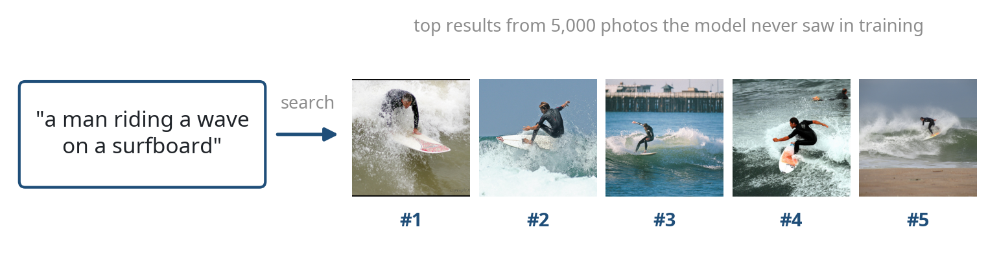

- We all have thousands of photos — scrolling to find one is painful
- Our system: **type a sentence → get the matching photos**
- These are **real results** from our model, on photos it never saw while training

<!-- Say: "This is a real query on our trained model. It searched 5,000 photos it had never seen, and all top five are surfers. Nobody tagged these photos — the model looked at the pixels." -->

---

## 2. The task, and how we score it

- **Input:** a collection of photos + a sentence describing one of them
- **Output:** the photos ranked from best match to worst

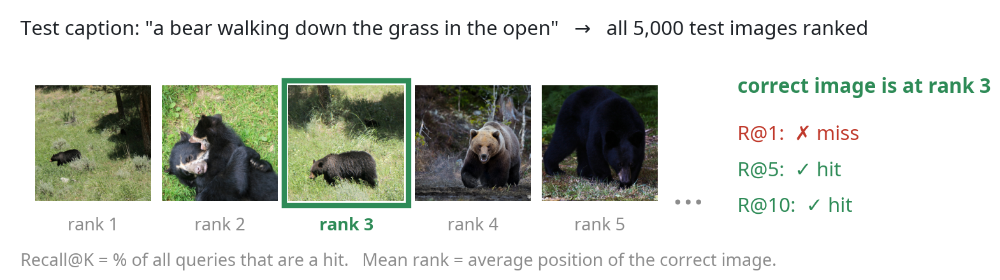

- **Recall@K (R@K)** = how often the right photo is in the **top K**. Higher is better.
- **Mean rank** = where the right photo lands on average. Lower is better.

<!-- Say: "To measure quality we take a caption written for a known photo and check where that photo lands. Here it is 3rd: a miss for R@1 but a hit for R@5 and R@10. We repeat this for all 25,000 test captions and report the percentage." -->

---

## 3. The data — Microsoft COCO 2017

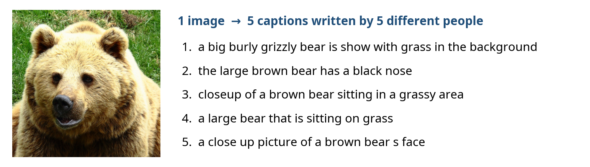

| | Training (to learn) | Validation (to pick best model) | Test (final score) |
|---|---|---|---|
| Photos | **113,287** | 5,000 | 5,000 — never seen in training |
| Captions | 566,435 | 25,000 | 25,000 |

<!-- Say: "COCO is a public dataset of everyday photos. Every photo was described by five different people. We learn from 113 thousand photos, pick our best model with 5,000 more, and report final scores on another 5,000 the model has never seen." Captions average about 10 words; 95% have 15 or fewer. -->

---

## 4. Preparing the captions

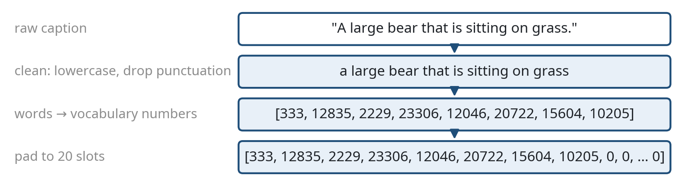

- The vocabulary (**26,351 words**) is built from the training captions only
- Each word starts with a **GloVe** vector — 300 numbers that already capture its meaning, learned from Wikipedia-scale text
- 20 slots is enough: only **0.6%** of captions get cut short

<!-- Say: "Computers need numbers, so every word gets an ID, and every ID gets a vector of 300 numbers from GloVe. GloVe already knows that 'dog' and 'puppy' are similar. It covers 99.87% of the words in our captions." Words never seen in training become <unk> — only 0.2% of test words. -->

---

## 5. Preparing the photos

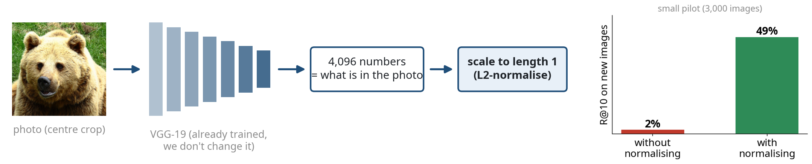

- **VGG-19** is a famous network already trained to recognise objects — we use it as-is
- Each photo becomes **4,096 numbers** describing what is in it
- **Scaling every vector to length 1 was essential** — without it the model just memorised (chart, right)
- The 19.3 GB image zip was **streamed**, never stored — we kept only 1.9 GB of numbers

<!-- Say: "We don't train the image network ourselves — VGG-19 already recognises objects. We ask it for 4,096 numbers per photo. One lesson we learned the hard way: those vectors must be scaled to the same length. In a small test, without that step the model scored 2%; with it, 49%." -->

---

## 6. Our approach — one shared space for photos and sentences

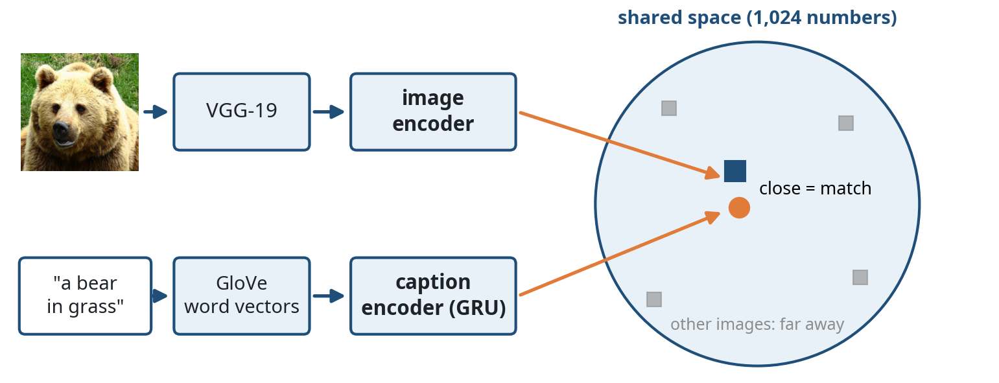

- Two **encoders** turn a photo and a sentence into **1,024 numbers** each — a point in the same space
- Training places matching pairs **close together**; searching = find the **nearest** photos

<!-- Say: "Photos and sentences are different kinds of data, so we can't compare them directly. We learn two encoders that map both into the same space. A sentence lands next to the photos it describes. Searching is then just measuring distance." -->

---

## 7. Baseline — average the words, fit one matrix

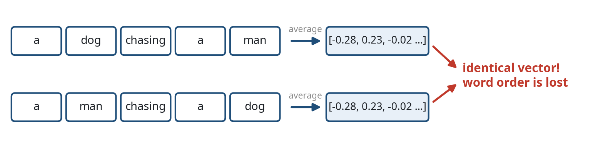

- Caption = **average of its word vectors** (300 numbers)
- One matrix `W` maps it to the photo's 4,096 VGG numbers — **least squares**, solved with one formula in seconds
- **Weakness:** averaging forgets word order and **dilutes** the important words

<!-- Say: "Our simple baseline averages the word vectors and fits a linear map, like linear regression with many outputs. It is fast, but look: 'a dog chasing a man' and 'a man chasing a dog' give exactly the same numbers. These are real GloVe values." -->

---

## 8. Main model — a GRU reads the caption word by word

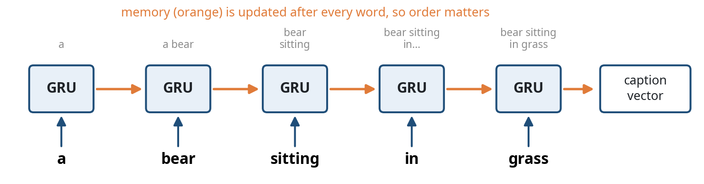

- **Caption encoder:** GloVe vectors → **GRU** (a recurrent neural network with a 1,024-number memory) → the caption's point
- **Image encoder:** one learned layer, 4,096 VGG numbers → 1,024
- **17.2 M** learnable numbers in total (7.9 M of them are the word vectors, which are fine-tuned)

<!-- Say: "Instead of averaging, a GRU reads the words in order and keeps a memory that it updates after each word. So it knows 'dog chasing man' is different from 'man chasing dog', and it learns which words matter." Based on Vendrov et al. (2015). -->

---

## 9. How it learns — the margin ranking loss

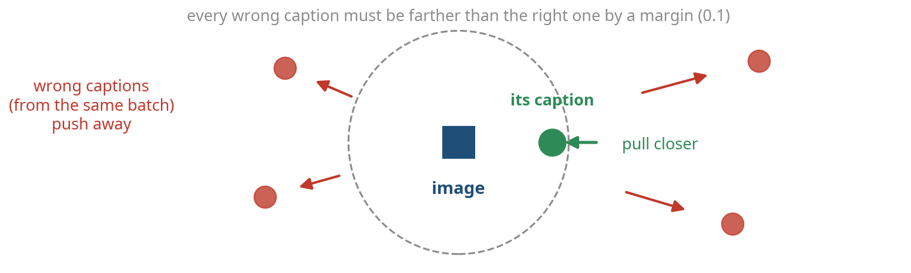

- In each batch of **128** pairs, every photo has 1 right caption and **127 wrong ones** (the other photos' captions) — free negatives
- Penalty whenever a wrong caption is not farther away than the right one by the **margin 0.1**

| Optimizer | Batch | Margin | Max words | Epochs | Time per epoch |
|---|---|---|---|---|---|
| Adam, learning rate 0.001 | 128 | 0.1 | 20 | 20 | ~1.4 min (laptop GPU) |

<!-- Say: "Training is a game of pull and push: pull each photo's own caption closer, push the other captions away. We never need extra labels — the other examples in the batch are the wrong answers." We also tried learning rate 0.05 (the reference paper's); the loss fell but accuracy stayed near chance, so we used 0.001. We keep the epoch with the best validation score. -->

---

## 10. Implementation — the pipeline

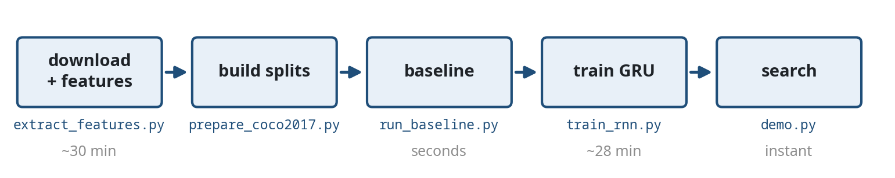

- **PyTorch** on an Apple **M3 Pro** laptop GPU (VGG-19 + GRU); **NumPy** for the baseline
- Feature extraction downloads only byte ranges of the 19.3 GB zip — never the whole file
- The demo encodes the 5,000 test photos **once**, so each query is answered instantly
- The best-validation model is scored on the test set **once**, at the end

<!-- Say: "Everything ran on a laptop. The full pipeline is five scripts — from raw COCO images to an interactive search demo." Other modules: data.py, glove.py, vocab.py, baseline.py, models.py, retrieve.py, remote_zip.py. -->

---

## 11. Results — test set (5,000 unseen photos)

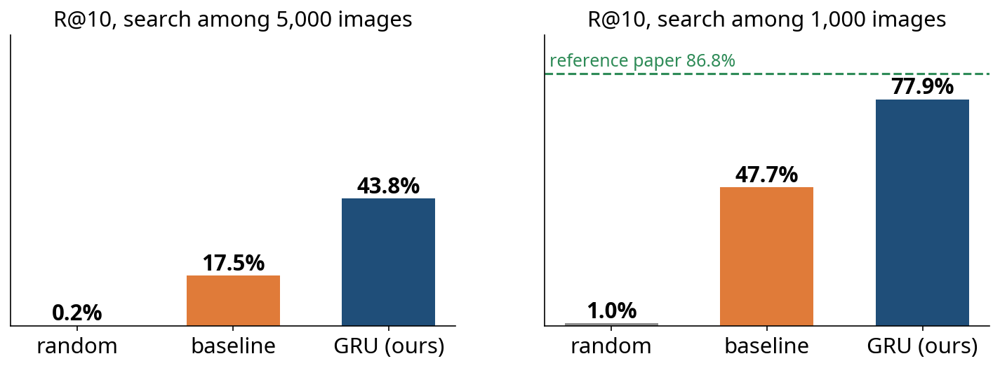

- The GRU beats the baseline on **every** measure: R@10 **17.5% → 43.8%** (2.5×)
- Average position of the right photo: **157th → 48th** out of 5,000 (top 1%)

5K: search all 5,000 test photos. 1K: the standard protocol from published papers — five groups of 1,000, averaged. Full table (R@1, R@5, mean rank) in the write-up.

<!-- Numbers to have ready. 5K — baseline R@1 2.8, R@5 10.7, R@10 17.5, mean rank 156.7; GRU 10.4, 30.6, 43.8, 48.1. 1K — baseline 9.7, 31.6, 47.7, 32.2; GRU 26.9, 62.4, 77.9, 10.4. Random guessing: R@10 0.2% (5K), 1% (1K). -->

---

## 12. More data helped most

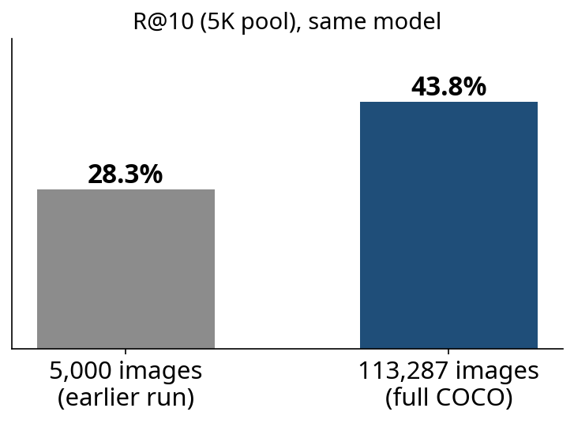

- An earlier run trained on only **5,000** photos: R@10 **28.3%**
- Full COCO, **23× more data**, same model: **43.8%** (+15.5 points)
- Reference paper (Stanford CS229): **86.8%** on 1K vs our **77.9%**
- Why we are ~9 points behind:
  - **20 epochs** vs up to 50 — ours was still improving
  - **1 crop** per photo vs their average of 10 crops
  - slightly different test photos

<!-- Say: "The biggest single improvement was simply using all the data. We are close to the published result; the remaining gap is explained by shorter training and simpler image features, which we chose to finish on time." Vendrov et al. (2015) GRU: 85.8% on 1K. -->

---

<!-- _class: tight -->

## 13. Demo — query: "a cycle"

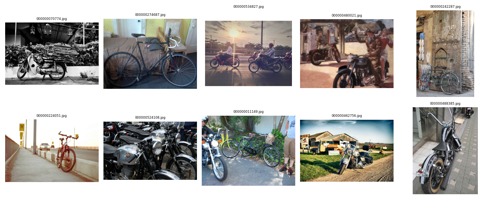

- **10 of 10** results are **bicycles or motorcycles** — all photos the model never saw
- "cycle" appears only **219 times** in training captions (vs 6,940 for "motorcycle")

<!-- Say: "Even a rare word works: the model learned that 'cycle' is related to bikes from just a few hundred examples, helped by GloVe." Our earlier 5k-photo model got 8 of 10, with a locomotive and a clock among the misses. -->

---

## 14. Training progress

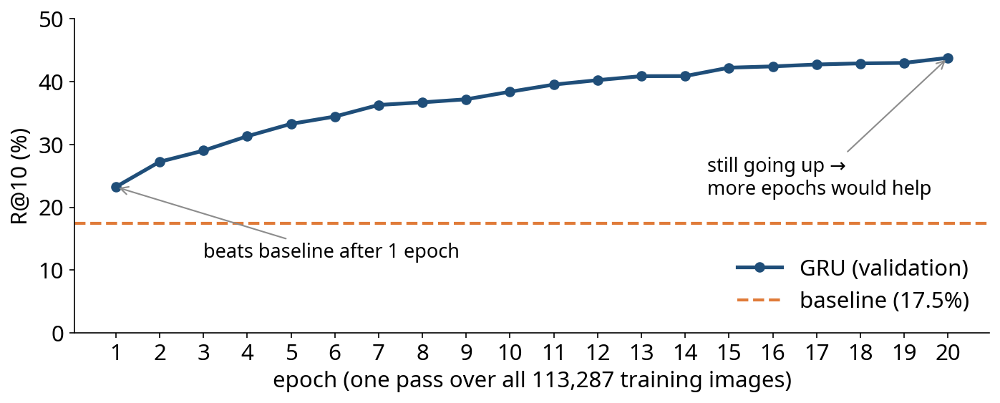

- After **one** pass over the data the GRU already beats the baseline (23.2% vs 17.5%)
- Still climbing at epoch 20 → **training longer should help**

<!-- Say: "Each epoch is one pass over all 113 thousand training photos and takes about 1.4 minutes. The curve has not flattened yet, so more epochs would likely close more of the gap to the paper." Loss fell from 180 to 24. -->

---

<!-- _class: tight -->

## 15. Where it fails — "two dogs playing in the snow"

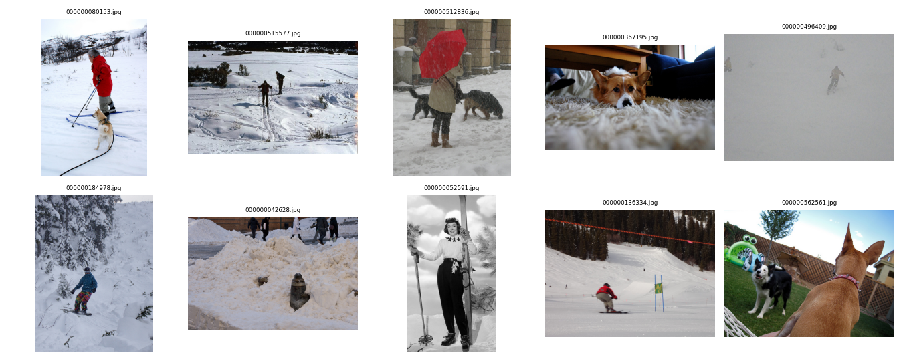

- It finds **snow** and **dogs** — but only **one** photo has *two* dogs in snow
- **Why:** each photo is **one summary vector**, so the model cannot count or check that things appear together

<!-- Say: "Being honest about limits: the sentence side understands 'two dogs' and 'snow', but the photo side is a single summary of the whole picture. It cannot look at regions or count objects. Fixing that needs attention over image regions." -->

---

## 16. Conclusions & future work

### What we showed
- A GRU sentence encoder **beats averaging words by 2.5×** (R@10 43.8% vs 17.5%)
- **More data mattered most**: 5,000 → 113,287 photos, +15.5 points
- **Scaling image vectors to length 1** was essential (2% → 49% in a pilot)
- Close to the published result (77.9% vs 86.8%), trained on a laptop

### Next steps
- Train **longer**, with **10-crop** image features
- Focus the loss on the **hardest** wrong answer (VSE++)
- Let the model look at **image regions** (attention) to handle counting and combinations

<!-- Say: "In short: reading words in order beats averaging, data scale matters most, and a small preprocessing detail made or broke the model." -->

---

<!-- _class: title -->

# Thank you

### Questions?

`github.com/Vishanth21/neural_caption-image_retrieval`
